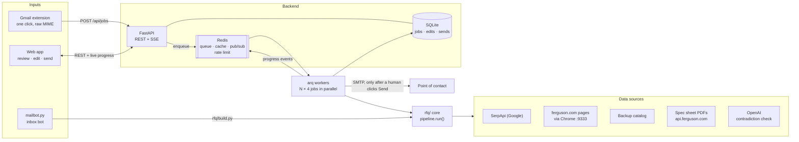
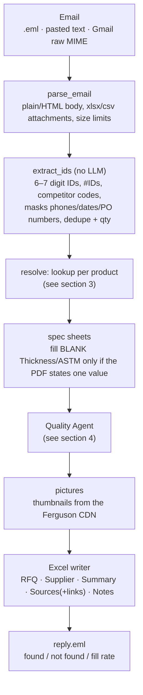
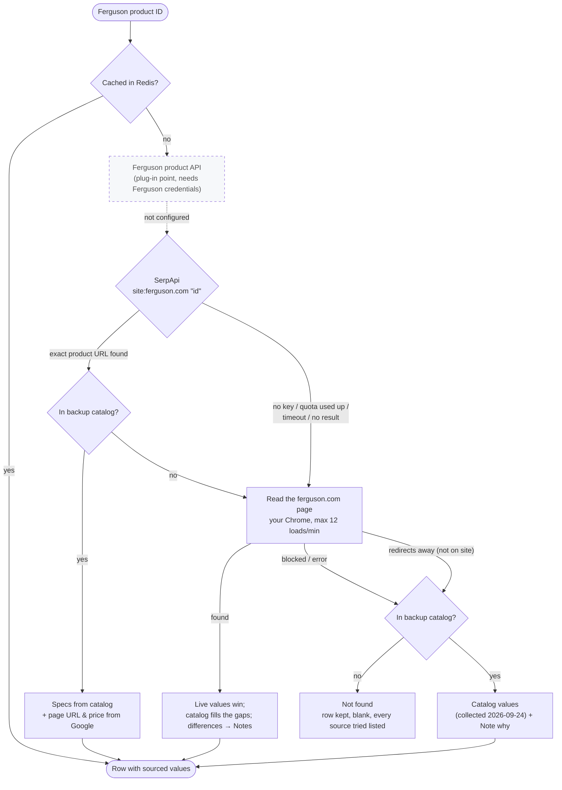
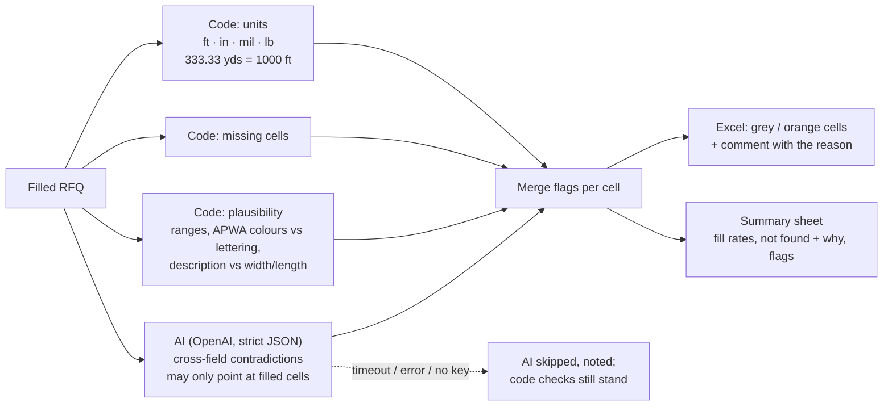
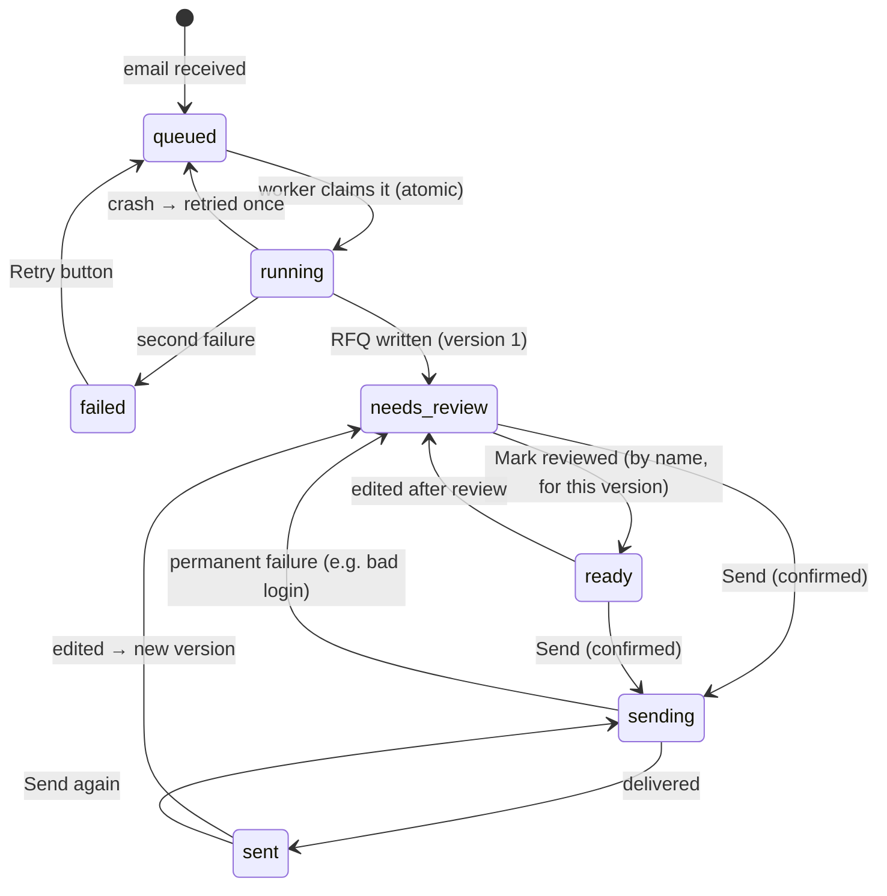
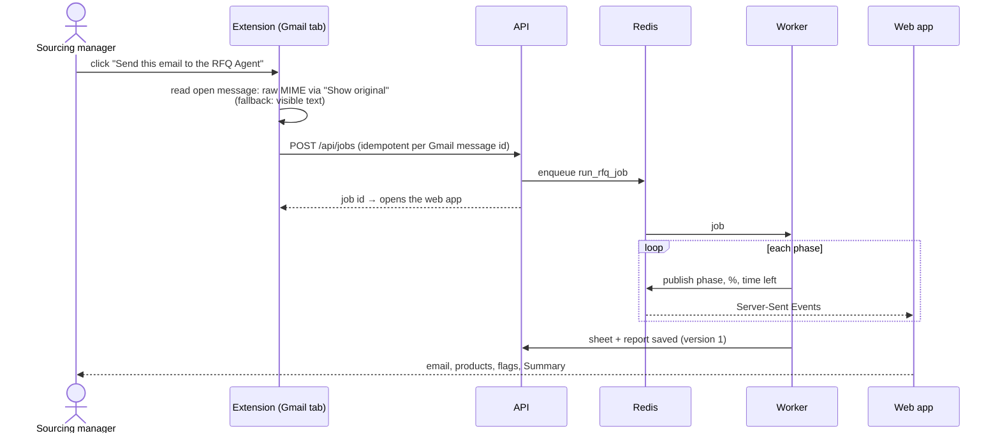
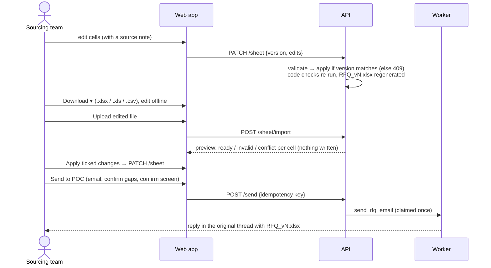
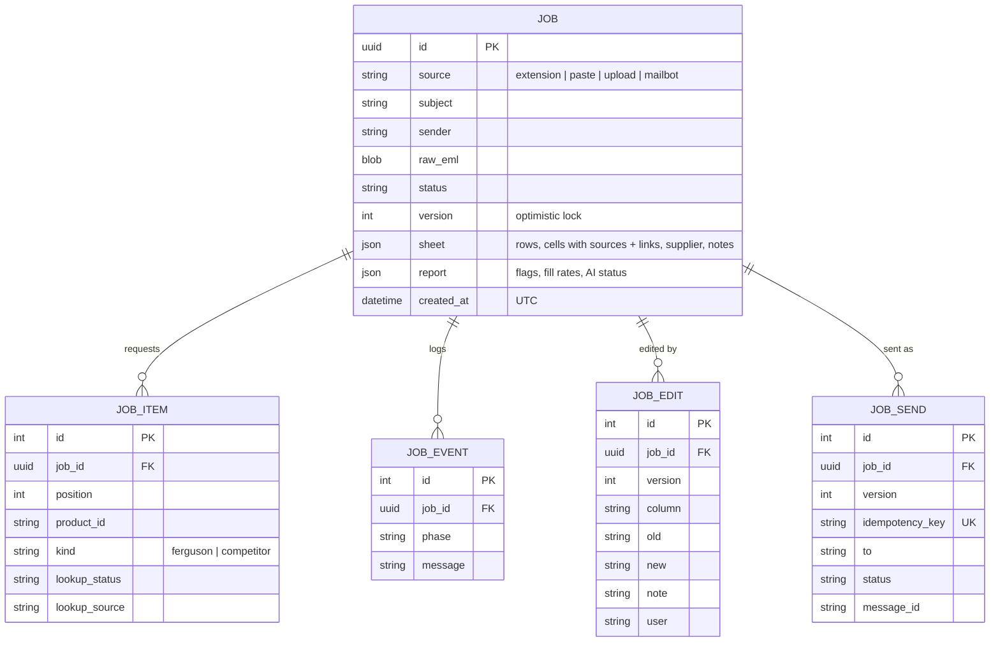

# Architecture

How the RFQ Agent turns a sourcing email into a reviewed, sourced RFQ workbook. Diagrams are
[Mermaid](https://mermaid.js.org); GitHub renders them in place.

- [1. System overview](#1-system-overview)
- [2. From email to RFQ (the pipeline)](#2-from-email-to-rfq-the-pipeline)
- [3. Product lookup and fallbacks](#3-product-lookup-and-fallbacks)
- [4. The agentic arm: RFQ Quality Agent](#4-the-agentic-arm-rfq-quality-agent)
- [5. Job lifecycle](#5-job-lifecycle)
- [6. Gmail extension → live progress](#6-gmail-extension--live-progress)
- [7. Human in the loop: review, upload, send](#7-human-in-the-loop-review-upload-send)
- [8. Data model](#8-data-model)
- [9. Reliability and guardrails](#9-reliability-and-guardrails)

## 1. System overview

| Part | Where | Job |
|---|---|---|
| Core flow | `rfq/` | Parse email → extract IDs → lookup → fill template → Quality Agent → Excel + reply. Plain Python; the CLI, the worker and an Azure wrapper call the same `rfq.pipeline.run()`. |
| Backend | `backend/app/` | API, SQLite storage, versioned editing, search, exports. Live progress: the worker publishes to Redis, the API relays it to the browser as Server-Sent Events. |
| Workers | `backend/app/worker.py`, `run_worker.py` | Run jobs in parallel, send email, recover stuck work; the supervisor restarts arq if Redis drops. |
| Web app | `frontend/` | Jobs list with database search, live progress, review grid, upload/download, send dialog. Ferguson branding. |
| Extension | `extension/` | One click in Gmail sends the open email (full raw message, including attachments). |

## 2. From email to RFQ (the pipeline)

Every value placed on the RFQ sheet gets a row on the Sources sheet: source type, confidence, the
source text and a **clickable link** to the page or PDF it came from. A blank cell means "no source had
it". Values are never guessed.

## 3. Product lookup and fallbacks

- **Competitor part numbers** (e.g. `17783-79-3000`, `MTX-4409-XQ`) are recognised and kept as `Not found` with
  the reason. The competitor finder arm is not built.
- **Rate limit:** a Redis sliding window shared by all workers, `FERGUSON_RATE_PER_MINUTE` (default 12), plus
  ~5 s spacing. Spec-sheet PDFs count against it too. Blocked pages are detected and retried once, and repeated
  blocks trigger a 10-minute cool-down.
- **SerpApi:** results are cached for 24 h. A used-up quota or a rejected key pauses SerpApi for 1 h. Fresh
  searches can take 20–60 s (`SERPAPI_TIMEOUT_S`, default 45).
- **Precedence:** live page > SerpApi > catalog, for both specs and supplier info (price, stock, part numbers).

## 4. The agentic arm: RFQ Quality Agent

The agent **flags and never overwrites**. Re-checks only re-ask the AI about rows that changed (cached per
row), and a re-check result is stored only for the version it checked.

## 5. Job lifecycle

## 6. Gmail extension → live progress

## 7. Human in the loop: review, upload, send

## 8. Data model

The editable RFQ is one versioned JSON document (`jobs.sheet` + `jobs.version`), so optimistic locking is a
single conditional `UPDATE`. The Excel file for each version is regenerated from it and kept as `RFQ_vN.xlsx`.

## 9. Reliability and guardrails

| Risk | What happens |
|---|---|
| ferguson.com blocks scraping | Real Chrome profile, 12 loads/min across all workers, block detection, retry, cool-down, catalog fallback with a Note |
| SerpApi slow, out of quota, key rejected | Timeout → page read; quota/key → paused 1 h, warning on the RFQ |
| AI fails or returns junk | Strict schema, unknown cells dropped, code checks still run, Summary says "AI skipped" |
| Redis down | API still serves reads; new jobs are saved and start when the queue is back (recovery sweep); CLI uses an in-memory cache |
| Worker dies mid-job | Atomic claim + recovery sweep re-queues; a job never runs twice |
| Two people edit at once | Version check → 409 for the slower one |
| Double click on Send | Idempotency key + atomic status claim → exactly one email |
| Prompt injection in emails/pages/PDFs | Treated as data, AI has no tools, can't choose recipients or URLs |
| Formula injection | External text is written as text; CSV export prefixes `=` `+` `@`; uploads refuse formulas |
| Bad uploads | Type/size/column/job checks, per-cell validation, conflicts unticked, nothing written before Apply |
| Images | Ferguson CDN only, type/size/pixel caps, cached; failures noted, link kept |
